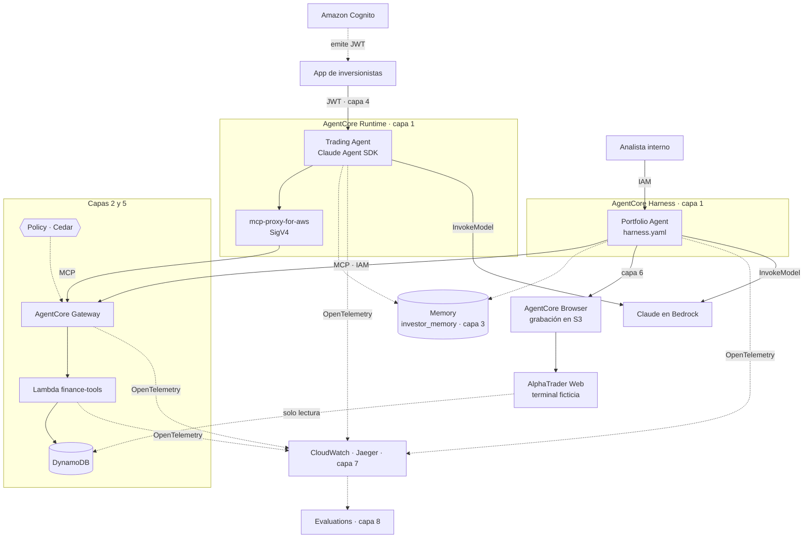

# AlphaInvest AI — demo por capas de Amazon Bedrock AgentCore

Demo de la charla **«Crear un agente de IA es solo el principio: conoce Amazon Bedrock AgentCore»** ([AWS User Group Jalisco](https://www.meetup.com/amazon-web-services-jalisco/events/316729535/), 5 de noviembre de 2026).

Dos agentes financieros autónomos sobre **datos simulados**, desplegados capa por capa para mostrar qué problema de producción resuelve cada servicio de AgentCore:

| Agente | Modalidad | Loop | Modelo (Amazon Bedrock) | Entrada |
| --- | --- | --- | --- | --- |
| **Trading Agent** | Code-based: **AgentCore Runtime** (contenedor ARM64) | Claude Agent SDK (Python) | `us.anthropic.claude-haiku-4-5-20251001-v1:0` | Usuarios finales con JWT (Cognito) |
| **Portfolio Agent** | Config-based: **AgentCore Harness** | Administrado por AgentCore | `us.anthropic.claude-sonnet-4-5-20250929-v1:0` | Interno, IAM |

Ningún agente sigue un flujo fijo: cada uno decide qué herramientas usar, si opera o se abstiene y cuándo termina. No hay dinero real, brokers ni datos de clientes.

## Arquitectura



### Qué es real y qué es simulado

| Real (servicios de AWS) | Simulado |
| --- | --- |
| Runtime, Harness, Gateway, Memory, Identity (Cognito), Policy, Browser, Observability, Evaluations, Bedrock, Lambda, DynamoDB, S3, CloudWatch, X-Ray | Precios (`AAPL` 250, `MSFT` 500, `NVDA` 200 USD), cambio porcentual, portafolio inicial (10 AAPL, 5 MSFT, 15 NVDA, 10 000 USD), noticias de AlphaTrader Web y ejecución de órdenes |

## Las capas

Cada script es idempotente: añade lo que falta a `agentcore.json`, `harness.yaml` o `cdk.json` y ejecuta `agentcore deploy --target $TARGET`. No despliegues en vivo; el primer build del contenedor tarda varios minutos.

| Capa | Comando | Problema que resuelve | Qué se ve en la demo |
| --- | --- | --- | --- |
| 1 | `layers/1-agents.sh` | ¿Dónde corre el agente? | Ambos agentes razonan, pero sin datos se abstienen. |
| 2 | `layers/2-gateway.sh` | ¿Cómo accede a herramientas y datos? | Herramientas MCP compartidas; lo que compra uno lo ve el otro. |
| 3 | `layers/3-memory.sh` | ¿Qué recuerda del usuario? | Preferencias dichas a un agente las aplica el otro en otra sesión. |
| 4 | `layers/4-identity.sh [usuario]` | ¿Quién es el usuario? | IAM rechazado; JWT aceptado; el `user_id` del payload no puede suplantar al del token. |
| 5 | `layers/5-policy.sh` | ¿Qué puede hacer cada agente? | Orden de 15 acciones negada (máx. 10); el Portfolio Agent no ve `simulate_trade`. |
| 6 | `layers/6-browser.sh` | ¿Y los sistemas sin API? | El agente lee AlphaTrader Web, ignora una inyección de prompt oculta y queda grabado. |
| 7 | `layers/7-observability.sh [--jaeger]` | ¿Qué pasó en cada invocación? | Trazas de agente, herramientas y Lambda en CloudWatch y Jaeger. |
| 8 | `layers/8-evaluations.sh` | ¿Qué tan bien lo hace? | Evaluadores integrados en línea sobre el tráfico real. |
| 9 | `uv run python layers/9_registry.py` (opcional) | ¿Qué agentes y herramientas existen? | Catálogo con aprobación y búsqueda. |
| — | Payments | Fuera de alcance | Requiere wallet de Coinbase CDP o Stripe/Privy. |

Todos los comandos se ejecutan desde la raíz del repositorio con `TARGET=dev|uat|prod` (por defecto, `dev`). Cada script muestra en un recuadro los comandos que ejecuta y el diff de `agentcore.json`, `harness.yaml` y `cdk.json`, y pide confirmación antes de desplegar; si respondes que no, restaura la configuración. Las salidas ocultan los IDs de cuenta para poder proyectarlas. Con `DRY_RUN=1`, un script aplica los cambios de configuración y ejecuta `agentcore build` sin desplegar; con `YES=1`, despliega sin preguntar.

### Detalle por capa

**2 · Gateway.** La Lambda `finance-tools` expone `get_stock_price`, `get_portfolio`, `simulate_trade` y `get_trade_history` como MCP. El estado vive en DynamoDB, con escritura transaccional (estado y bitácora) y bloqueo optimista. El Trading Agent se conecta con [`mcp-proxy-for-aws`](https://github.com/aws/mcp-proxy-for-aws) firmando con su rol; el Harness, con la herramienta `agentcore_gateway`. `cdk-stack.ts` inyecta el ARN real del Gateway en cada ambiente.

**3 · Memory.** Hay una sola memoria, `investor_memory`, con la estrategia `USER_PREFERENCE` y namespace `/users/{actorId}/preferences`:

- **Runtime:** la integración vive en [`memory.py`](AlphaInvest/app/trading_agent/memory.py). Antes de razonar recupera preferencias y los últimos turnos; al terminar guarda el turno.
- **Harness:** basta con `agentCoreMemoryConfiguration: {name: investor_memory}` en `harness.yaml`.

**4 · Identity.** Cognito (user pool y app client) se crea en el stack de cada ambiente. El Runtime pasa a `CUSTOM_JWT` y recibe el header `Authorization`; el agente toma el usuario del token, que AgentCore ya validó. Para crear usuarios de prueba: `scripts/identity-user.sh <usuario>`. La contraseña se genera al azar y se guarda en `.local/`, fuera de git.

**5 · Policy.** Las plantillas Cedar están en [`app/policies/`](AlphaInvest/app/policies/); `cdk-stack.ts` sustituye el ARN del Gateway y los roles de cada ambiente. El modelo es de denegación por defecto:

- ambos agentes pueden leer;
- solo el rol del Trading Agent opera, con `quantity <= 10` y `side` igual a BUY o SELL.

**6 · Browser.**

- **AlphaTrader Web** ([`web_terminal.py`](AlphaInvest/app/finance_tools/web_terminal.py)) es una terminal ficticia de solo lectura sobre el mismo DynamoDB, publicada con una Lambda Function URL.
- El navegador administrado es propio (`CfnBrowserCustom`) y graba cada sesión en S3: cifrado, privado y con borrado a 7 días.
- Una noticia contiene a propósito un texto oculto con una instrucción maliciosa. Para mostrarla al público, abre `$URL?reveal=1`: la misma página la resalta en rojo. El agente usa la URL normal.
- La terminal muestra la composición del portafolio (gráfica de barras) y las operaciones recientes de la bitácora, así que en la grabación se ve lo que operó el Trading Agent.
- Las órdenes solo pasan por Gateway y Policy; la terminal no acepta escritura.

**8 · Evaluations.** Usa `Builtin.GoalSuccessRate`, `Builtin.ToolSelectionAccuracy` y `Builtin.Helpfulness`:

- Runtime: declarado con `agentcore add online-eval`.
- Harness: en `cdk-stack.ts`, con el log group de su runtime subyacente.
- Muestreo del 100 % en dev y uat, y del 10 % en prod.

## Requisitos

- Cuenta de AWS con acceso en Amazon Bedrock a los dos perfiles de Claude de la tabla, en `us-east-1`.
- AgentCore CLI `@aws/agentcore` ≥ 1.0.1, AWS CLI v2, Node.js ≥ 20, `uv`, `jq`, Python 3.12.
- Docker, solo para Jaeger local o `agentcore dev`; el contenedor del Runtime se construye en AWS CodeBuild.
- Permisos para desplegar con AWS CDK (CloudFormation, IAM, ECR, CodeBuild, Lambda, DynamoDB, S3, Cognito, AgentCore).

## Uso

```bash
uv sync                                 # dependencias de desarrollo y pruebas
scripts/test.sh                         # pruebas unitarias (sin AWS) + agentcore build
scripts/targets.sh                      # ambientes dev, uat y prod (ver abajo)
TARGET=dev layers/1-agents.sh           # … y así cada capa en orden
```

### Desarrollo local con trazas en Jaeger

```bash
scripts/jaeger-local.sh                 # Jaeger v2: http://localhost:16686
scripts/run-local.sh                    # Trading Agent en :8080 + servidor MCP local + OpenTelemetry
scripts/invoke-local.sh "Analiza AAPL y MSFT y realiza una operación de paper trading si consideras que hay una oportunidad."
```

### Invocar los agentes desplegados

```bash
uv run python scripts/invoke_aws.py trading \
  "Analiza AAPL y MSFT y realiza una operación de paper trading si consideras que hay una oportunidad." --user ana
uv run python scripts/invoke_aws.py portfolio \
  "Analiza mi portafolio actual y recomienda cómo mejorar la diversificación." --user ana
```

- Con la capa 4, `trading` obtiene un JWT de Cognito para `--user` e invoca por HTTPS; sin ella, usa SigV4.
- `--session` (≥ 33 caracteres) continúa una conversación.
- `TARGET=dev scripts/reset-portfolio.sh [--history]` reinicia el portafolio.

### Browser: Live View, cierre y grabación

```bash
URL=$(aws cloudformation describe-stacks --stack-name AgentCore-AlphaInvest-dev \
  --query "Stacks[0].Outputs[?OutputKey=='AlphaTraderWebUrl'].OutputValue" --output text)
uv run python scripts/invoke_aws.py portfolio \
  "Abre la terminal AlphaTrader Web en $URL con el navegador, revisa las noticias del mercado de hoy y dime si cambian tu recomendación de diversificación." --user ana
TARGET=dev scripts/browser-sessions.sh          # sesiones; Live View en consola → AgentCore → Browser
TARGET=dev scripts/browser-sessions.sh --stop   # cierra, espera la grabación y la resume
```

La sesión del navegador **queda abierta** después de la respuesta del Harness. Mientras siga así, factura y la grabación no llega a S3. `browser_recording.py` descarga la grabación en `.local/recordings/<sesión>/`, imprime la línea de tiempo y genera `replay.html` (rrweb-player). El replay oficial está en la consola: Browser → sesión → **View Recording**.

### Observabilidad y evaluaciones

```bash
TARGET=dev layers/7-observability.sh --jaeger   # trazas recientes + copia de spans de CloudWatch a Jaeger local
(cd AlphaInvest && agentcore eval online-eval list)
```

En la consola: CloudWatch → **GenAI Observability** → Bedrock AgentCore, con sesiones, trazas, tokens, errores y evaluaciones.

## Ambientes: dev, uat y prod

Cada entrada de `agentcore/aws-targets.json` es un ambiente y genera su propio stack: `AgentCore-AlphaInvest-<target>`. Los nombres físicos incluyen el target (`AlphaInvest_dev_trading_agent`), así que los ambientes pueden convivir en una cuenta o separarse en cuentas distintas.

```bash
scripts/targets.sh                                            # dev, uat y prod en la cuenta actual
DEV_ACCOUNT=… UAT_ACCOUNT=… PROD_ACCOUNT=… scripts/targets.sh # una cuenta por ambiente (recomendado)
```

| Práctica | Cómo se aplica aquí |
| --- | --- |
| Mismo código, distinta configuración | Un `agentcore.json`; las diferencias por ambiente están en `cdk-stack.ts`. |
| Promoción | Desplegar el mismo commit en orden: `dev` → `uat` → `prod`, idealmente desde CI/CD. |
| Datos protegidos en prod | DynamoDB, Cognito y el bucket de grabaciones con `RETAIN`; tabla y user pool con protección contra borrado; PITR en la tabla. |
| Costo en prod | Evaluación del Harness al 10 % del tráfico. |
| Versiones dentro de un ambiente | Cada cambio crea una versión inmutable del Runtime; `DEFAULT` apunta a la última. Para fijar una: `agentcore add runtime-endpoint --runtime trading_agent --name stable --version N`. |

`aws-targets.json` contiene IDs de cuenta y está en `.gitignore`. El CLI no tiene un comando de promoción: promover es desplegar el mismo commit en otro target. El nombrado de stacks por target está verificado en el código de `@aws/agentcore-cdk` 1.0.0.

### Qué no se versiona

El repositorio no contiene credenciales, IDs de cuenta ni ARNs. El [`.gitignore`](.gitignore) excluye:

- `AlphaInvest/agentcore/aws-targets.json` y `AlphaInvest/agentcore/.cli/`: cuentas y estado del despliegue; `scripts/targets.sh` los regenera.
- `.local/`: contraseñas de usuarios de prueba de Cognito y grabaciones del navegador.
- `.env*`, `.venv/`, `node_modules/`, `cdk.out/` y cachés de Python.

## Builder (Runtime) vs. Harness

| | Runtime + Claude Agent SDK | Harness |
| --- | --- | --- |
| Loop del agente | Tu código | Administrado por AgentCore |
| Cambiar modelo, prompt o herramientas | Código o variables y redespliegue | `harness.yaml`, o por invocación |
| Herramientas | Las que conectes (MCP vía proxy SigV4) | Declarativas: Gateway, Browser, Code Interpreter, MCP remoto, inline |
| Memory | Integración en código (~80 líneas) | 3 líneas de YAML |
| Límites | `max_turns`, `max_budget_usd`, timeout en código | `maxIterations`, `maxTokens`, `timeoutSeconds` |

## Seguridad

- **Trading Agent:** sin herramientas integradas (sin Bash, archivos ni web); solo el MCP `finance`. Límites: 10 turnos, 0.25 USD, 120 s y prompt de 4 000 caracteres.
- **Portfolio Agent:** `allowedTools` = `@finance` y `@browser`; sin `shell` ni `file_operations`. Límites: 12 iteraciones, 20 000 tokens y 180 s.
- **Gateway:** autorización `AWS_IAM` más Policy en modo `ENFORCE`, con denegación por defecto.
- **Lambda:** valida símbolo, lado, cantidad, efectivo y posiciones; no registra argumentos completos ni credenciales.
- **AlphaTrader Web:** URL pública a propósito para que el navegador administrado la alcance. Solo sirve HTML ficticio por GET, con CSP restrictiva. Se elimina con el stack.
- **Sin secretos en el repositorio.** Credenciales por roles de IAM y la cadena estándar de AWS.
- **Simplificado para la demo:** el rol del Runtime puede invocar cualquier perfil de inferencia de la cuenta; en producción, restríngelo al perfil usado.

## Costos y limpieza

Generan cargos: invocaciones de Claude, Runtime, Harness, Gateway, Lambda, DynamoDB, Memory, Browser (por sesión abierta), Evaluations (inferencias del juez), CodeBuild, ECR, S3 y CloudWatch (logs y spans). Usa un presupuesto con alarmas.

```bash
TARGET=dev scripts/browser-sessions.sh --stop   # cierra sesiones de navegador abiertas
TARGET=dev scripts/cleanup.sh                   # borra el stack del ambiente; pide confirmación
scripts/jaeger-local.sh stop
scripts/reset-config.sh                         # configuración local de vuelta a la capa 1 (no toca AWS)
TARGET=dev uv run python layers/9_registry.py --delete   # si usaste Registry
```

## Pruebas

```bash
uv run pytest                                        # unitarias, sin AWS
TARGET=dev uv run pytest -m aws -o addopts=""        # integración contra un ambiente desplegado
```

Las de integración verifican:

- el contrato de la Lambda;
- el uso de herramientas por ambos agentes;
- el rechazo de SigV4 con Identity y el usuario tomado del token;
- que Policy oculte `simulate_trade` al Portfolio Agent.

## Fuentes

Verificadas el **3 de noviembre de 2026**:

- [Harness](https://docs.aws.amazon.com/bedrock-agentcore/latest/devguide/harness-get-started.html) · [herramientas](https://docs.aws.amazon.com/bedrock-agentcore/latest/devguide/harness-tools.html) · [memoria](https://docs.aws.amazon.com/bedrock-agentcore/latest/devguide/harness-memory.html) · [seguridad](https://docs.aws.amazon.com/bedrock-agentcore/latest/devguide/harness-security.html)
- [Gateway: targets Lambda](https://docs.aws.amazon.com/bedrock-agentcore/latest/devguide/gateway-add-target-lambda.html) · [targets MCP](https://docs.aws.amazon.com/bedrock-agentcore/latest/devguide/gateway-target-MCPservers.html)
- [Runtime: JWT y OAuth](https://docs.aws.amazon.com/bedrock-agentcore/latest/devguide/runtime-oauth.html) · [versiones y endpoints](https://docs.aws.amazon.com/bedrock-agentcore/latest/devguide/agent-runtime-versioning.html)
- [Policy](https://docs.aws.amazon.com/bedrock-agentcore/latest/devguide/policy.html) · [políticas por acción](https://docs.aws.amazon.com/bedrock-agentcore/latest/devguide/example-policies-action-resource.html) · [por principal](https://docs.aws.amazon.com/bedrock-agentcore/latest/devguide/example-policies-principal.html)
- [Browser](https://docs.aws.amazon.com/bedrock-agentcore/latest/devguide/browser-tool.html) · [grabación y replay](https://docs.aws.amazon.com/bedrock-agentcore/latest/devguide/browser-session-recording.html)
- [Evaluations](https://docs.aws.amazon.com/bedrock-agentcore/latest/devguide/evaluations.html) · [Claude Agent SDK en Observability](https://docs.aws.amazon.com/bedrock-agentcore/latest/devguide/supported-frameworks-claude-agent-sdk.html)
- [Registry](https://docs.aws.amazon.com/bedrock-agentcore/latest/devguide/registry.html) · [Payments](https://docs.aws.amazon.com/bedrock-agentcore/latest/devguide/payments.html) · [regiones](https://docs.aws.amazon.com/bedrock-agentcore/latest/devguide/agentcore-regions.html)
